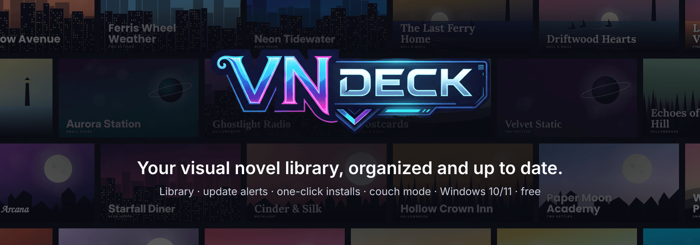
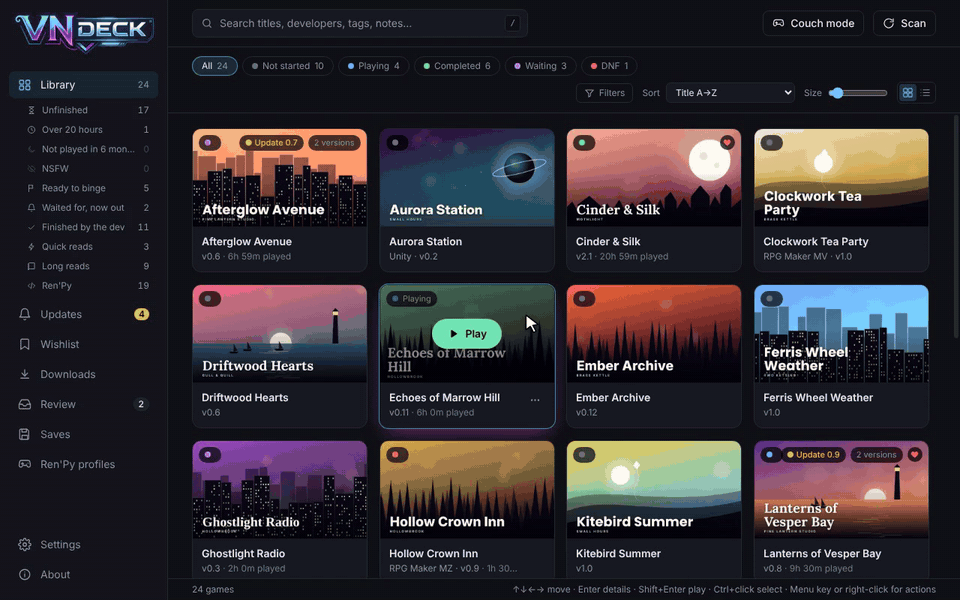
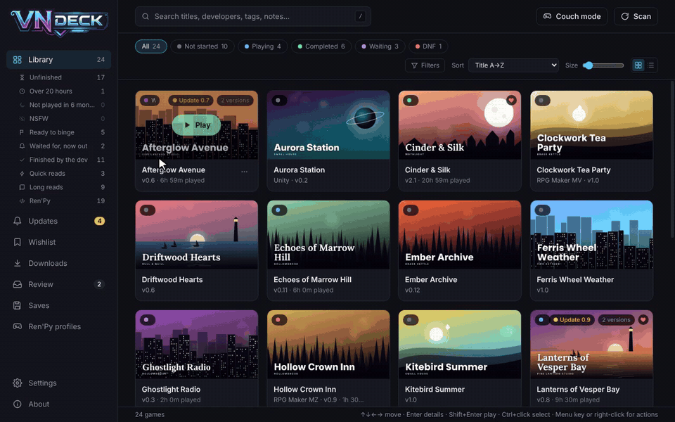
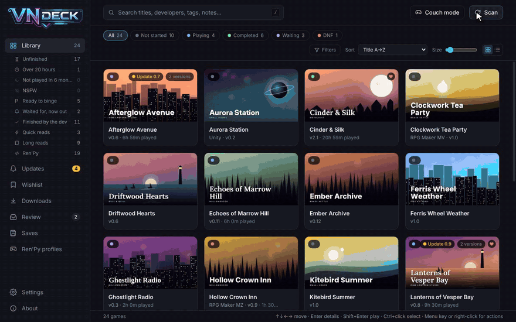
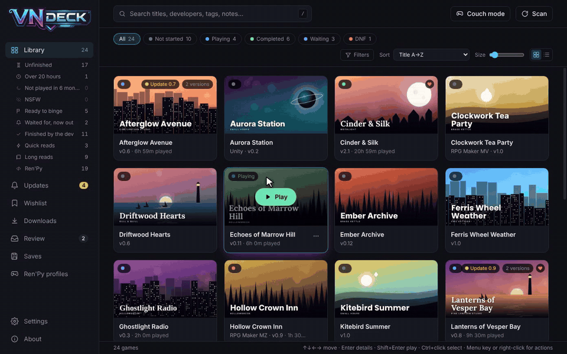

  <b><a href="https://albatrosslabs.itch.io/vn-deck">⬇ Download on itch.io</a></b> &nbsp;·&nbsp;
  <a href="https://discord.gg/qrBpVFBHu">Discord</a> &nbsp;·&nbsp;
  <a href="https://github.com/AlbatrossLabs/VNDeck/issues">Report a bug</a> &nbsp;·&nbsp;
  <a href="https://github.com/AlbatrossLabs/VNDeck/releases">Release notes</a>

---

VN Deck is a library and launcher for the visual novels you download yourself, from itch.io, F95zone and anywhere else. Point it at your game folders: it finds every game, groups the versions you've kept, pulls covers from the game files, and tells you when a new version is out. When one is, it installs it next to the old one.

Ren'Py, RPG Maker, Unity, HTML/Twine and more. Windows 10 and 11. Free.

## What's in it

- **Your library, sorted.** Engine detection, versions grouped, covers from the game files, play time per game and per version. Folders you already use, like "Completed" or "On hold", set each game's status.
- **Your progress and theirs.** Your status (Playing, Completed, Waiting for next release, DNF) next to the game's own development status from its pages: finished, in development, on hold or abandoned.
- **How long it is.** Ren'Py games are measured from their script's dialogue, so you know a 2-hour read from a 40-hour one before you start. Other games use VNDB players' play times.
- **Update alerts.** Each game is matched to its itch.io, F95zone and VNDB pages and checked on a schedule. Windows notifications and a tray badge when something's new.
- **One-click installs.** itch.io updates download through itch's official API. F95zone links open in VN Deck's own window, where you click through the host's page and VN Deck catches the file. Archives already in your folders install in one click. New versions go into a new folder next to the old one.
- **Smart views.** Ready to binge, Waited for (now out), Finished by the dev, Quick reads, Long reads, plus filters, tags (including tags imported from the pages), bulk edit, wishlist and notes with checklists.
- **Ren'Py extras.** Controls profiles for keyboard, controller and arcade stick, applied at launch and removed after. Reading progress, save backup and restore, a gallery unlock switch, and mods added for one session.
- **Couch mode.** Full screen for a TV, an arcade cabinet or a VR virtual screen, driven by a controller, keyboard or arcade stick.
- **Privacy.** Everything stays on your PC. Blurred covers for anything tagged NSFW, discreet mode, an optional PIN, and a blur switch in the art browser.

## A look around

<b>Library and smart views</b>: sort by length, <i>Ready to binge</i>, <i>Waited for, now out</i>, filters by development and length.

<b>Updates</b>: a new version is out, one click downloads it and installs it next to the old one.

<b>Couch mode</b>: shelves for a TV or a cabinet, made for a controller.

<b>A game's page</b>: description, development status, length, play time, and the art inside the game.

The games in these clips are made up for the demo.

## Get it

**[Download VN Deck on itch.io](https://albatrosslabs.itch.io/vn-deck).** Free, with an optional tip if you like it.

- **Requirements:** Windows 10 or 11, 64-bit. [7-Zip](https://7-zip.org) recommended for .rar files. No Steam Deck, Linux or Mac version yet.
- **Windows SmartScreen:** VN Deck isn't code-signed yet, so the first run shows "Windows protected your PC". Choose **More info → Run anyway**.

Direct downloads from GitHub

The [release files here](https://github.com/AlbatrossLabs/VNDeck/releases/latest) are the same builds as on itch.io. Installed copies also get their automatic updates from them. Each release lists the SHA-256 of its files so you can check a download.

| File | Use it if |
| --- | --- |
| `VN.Deck-Setup-x.y.z.exe` | You want it installed. It updates itself when a new version is out. |
| `VN.Deck-Portable-x.y.z.exe` | You want one file you can run from anywhere. It tells you about new versions; you download them yourself. |

**First run:**

1. Add the folder (or folders, on any drive) where your games live. VN Deck scans them and builds the library.
2. Open **Review** to confirm which itch.io, F95zone or VNDB page belongs to each game it wasn't sure about. From then on it checks them for new versions.
3. Optional: add your itch.io API key in **Settings → Updates & downloads** so itch.io updates download and install by themselves.

### Couch mode controls

| Controller | Keyboard | Does |
| --- | --- | --- |
| D-pad / left stick | Arrow keys | Move |
| A | Enter | Open the game |
| B | Esc | Back (on a shelf: jump to its start) |
| X | X | Play right away |
| Y | F | Favorite |
| LB / RB | Q / E or Page Up / Page Down | Skip six games along a shelf |
| Start | M | Menu (leave couch mode, quit VN Deck) |
| Hold **RB**, press **Start** (in a game) | | Quit the game, back to VN Deck |

Arcade sticks in keyboard mode (X-Arcade and similar) work out of the box. The in-game quit combo works in Ren'Py and HTML games; turn it off in **Settings → Couch mode**.

## No game files

VN Deck doesn't include, host or sell any games. It organizes and launches the games you already have, looks up public information about them, and downloads files only when you ask it to. Many games it works with are for adults only; following each site's terms and the laws where you live is up to you.

## Good to know

- **Your game folders are left alone.** VN Deck only reads them, with a few exceptions you choose: a temporary script it adds to Ren'Py games while they run (removed when they close), new versions you install (always into a new folder), and old versions or archives you send to the Recycle Bin.
- **Your data stays on your PC** in `%APPDATA%\VNDeck`. VN Deck sends nothing about you or your library anywhere. The only requests it makes are game-page lookups, downloads you start, and its own update check.
- **F95zone:** VN Deck reads public pages and the latest-updates list politely, at most one request every 3 seconds. It never automates sign-in, masked links, countdowns or captchas; downloads from F95 links always go through a page you click yourself.
- **Unpacking** uses 7-Zip if it's installed, otherwise Windows' built-in `tar` (fine for .zip and .7z; .rar only on recent Windows 11).
- **Moving to a new PC:** **Settings → Backup** makes one .zip of your library (play time, notes, tags, covers, save backups) to restore on the other PC.

## Found a bug? Have an idea?

- **Bugs:** [open an issue](https://github.com/AlbatrossLabs/VNDeck/issues). **About** in VN Deck's sidebar has a log you can copy into it.
- **Ideas, questions, or just talking VNs:** the [Discord](https://discord.gg/qrBpVFBHu).

## About

VN Deck is made by Albatross Labs. It's free to use; if it saves you time, you can chip in on [its itch.io page](https://albatrosslabs.itch.io/vn-deck).

© 2026 Albatross Labs. See [LICENSE.txt](LICENSE.txt): what you can do with VN Deck, that it comes without warranty, and that it should only be downloaded from [its itch.io page](https://albatrosslabs.itch.io/vn-deck) or this GitHub page. Open-source components are listed in THIRD-PARTY-NOTICES.txt, installed next to VN Deck.exe. VN Deck isn't affiliated with F95zone, itch.io, VNDB, Ren'Py, Valve or LaunchBox.
